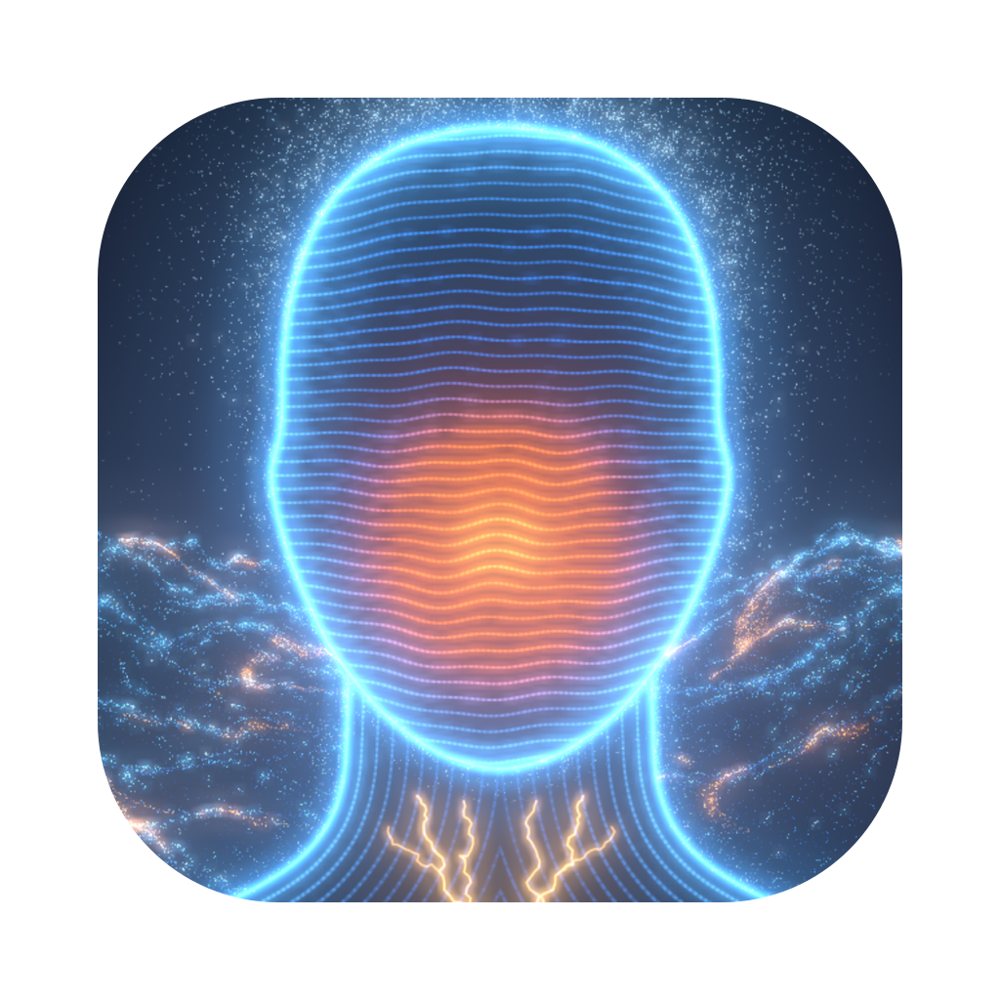

# STEM

Assistente vocale stile JARVIS per il Mac: ragiona col tuo `~/.claude/CLAUDE.md`, ascolta sempre, parla con voce ElevenLabs, naviga su Google, usa le app e lo schermo al posto tuo.

## Avvio
- **App STEM:** doppio clic su `STEM.app` (o Spotlight, o trascinala nel Dock). Si apre l'HUD a schermo intero: le particelle si raccolgono nella sfera, poi gli anelli si disegnano. Se STEM è già acceso, riapre solo l'HUD. Quando chiudi l'HUD (Cmd+Q), STEM si spegne da solo entro un paio di minuti, qualcuno in più se sta ancora facendo memoria.
- **Da Terminale:** `./avvia.command`, utile anche la prima volta per inserire la chiave ElevenLabs. Ctrl-C o chiudere la finestra spegne tutto.

## Parlare con STEM
- **Sempre in ascolto**, senza tasti: STEM capisce da solo quando parli con lui. Una frase è per lui se:
  - contiene il suo nome (anche storpiato dal riconoscitore);
  - arriva entro 25 secondi dalla sua ultima risposta, cioè siete in conversazione;
  - comincia con un comando ("apri…", "cerca…", "dimmi…", "puoi…").

  Se una frase non era per lui, il cervello risponde `[ignora]` e tace.
- **Più rapido:** il cervello è un processo Claude Code sempre acceso, con Opus 5.5 a effort medio, quindi comincia a rispondere in circa 2 secondi (con Sonnet, `STEM_MODEL=sonnet` in `.env`, in meno di 1). Se fai una pausa a metà di una richiesta, STEM parte già e, se poi continui, riparte con la frase completa.
- **Interromperlo:** mentre parla di' "stop", "basta" o "aspetta", oppure chiamalo per nome. `Esc` lo zittisce.
- **La scheda dell'ascolto:** in basso, sotto la sfera, STEM scrive quello che dici mentre lo dici. A frase finita aggiunge cosa ne ha fatto: «PER STEM · NOME», «PER STEM · CONVERSAZIONE», «NON PER STEM». Così vedi subito perché non ti ha risposto.
- **Privacy:** l'ascolto usa il riconoscimento vocale locale di Chrome: l'audio della stanza non esce dal Mac. Le frasi della scheda dell'ascolto restano sullo schermo e non finiscono in nessun registro. In `runtime/ascolto.log` STEM annota solo se una frase era per lui e la prima parola di quelle scartate, per capire come il riconoscitore ti sente.

## Cosa vedi
- **La sfera è il cervello di STEM.** È fatta di particelle e filamenti, dentro anelli che girano a velocità diverse:
  - in attesa respira piano;
  - quando parli si accende col microfono;
  - quando pensa nei filamenti corrono gli impulsi e un arco scansiona gli anelli;
  - quando parla pulsa con la voce.
- **Intorno alla sfera** ci sono i dati veri, appesi agli anelli: lo stato, la voce in uso, quanto ha messo a rispondere l'ultima volta, il microfono in dB, browser e agenda, gli fps.
- **Ai bordi** scorrono i micro-dati: a sinistra lo spettro del microfono in esadecimale, a destra gli eventi (domande, strumenti, voce, mai le frasi), in alto ora e memoria.
- **I colori:**
  - ciano vuol dire che tutto va;
  - arancione è un'anomalia da guardare: microfono negato o spento, calcolo degli sforzi fallito;
  - rosso è un'anomalia seria: server o cervello persi, un pezzo dell'ologramma che cede.

  La causa è scritta sotto lo stato.

## Cosa fa
- **Browser:** lavora su Google in un Chrome suo, sempre nella stessa pagina. Il pannello compare nell'HUD **solo per i compiti complessi** (ricerche lunghe, creazioni); le cose banali le fa in silenzio e ti dice il risultato.
- **GIF ed esempi:** quando spiega, mostra accanto alla sfera animazioni da Wikimedia Commons (per esempio un motore a quattro tempi); per le GIF simpatiche serve una chiave gratuita GIPHY in `.env` (`GIPHY_API_KEY`, da developers.giphy.com).
- **Report a schermo intero:** alla fine di una ricerca che vuoi vedere, STEM apre un report come quello di ROSE. È una griglia di note, grafici, un dato in grande, immagini e video di YouTube muti, che arrivano dal fondo e si mettono a fuoco uno alla volta, con i loro suoni, mentre lui si sposta nell'angolo in basso a destra. Le note in più si alternano ogni 9 secondi. Si chiude con `Esc`, oppure chiedendoglielo.
- **Ologrammi:** chiedigli di mostrarti un oggetto in 3D («mostrami un motore a reazione», «fammi una staffa a L in alluminio») e lo costruisce a schermo intero, con misure in millimetri.
  - **Cosa ci fai:** lo giri, lo esplodi, lo tagli, guardi dentro ai raggi X e togli i pezzi, a voce («esplodilo», «taglialo a metà», «togli il coperchio»), col mouse, con la tastiera o con le mani davanti alla fotocamera.
  - **Le mani:** un pizzico gira il modello, con due mani lo ingrandisci, aprendo i palmi lo esplodi, e un pezzo afferrato e lanciato via si toglie.
  - **I tasti:** E esplodi, S taglia, X raggi X, F sforzi, R torna com'era, Z rimette l'ultimo pezzo tolto, M accende o spegne le mani, Esc chiude.
  - **Gli sforzi:** se gli dici il materiale, dove è fissato e che forza riceve, STEM calcola gli sforzi e li colora dal blu al rosso; il rosso è dove il materiale cede. È una stima statica lineare: buona per capire dove lavora un pezzo, non una garanzia per costruirlo.
  - **Prima volta:** il Mac e l'HUD chiedono il permesso della fotocamera; se dici di no, restano mouse, tastiera e voce. I fotogrammi non escono dal Mac.
  - **I limiti:** un oggetto vero fatto da STEM è stilizzato, e per quello vero conviene scaricare un modello, per esempio da Sketchfab in GLB. Un oggetto nuovo può richiedere quasi un minuto.
- **Il Mac:** apre e chiude app, guarda lo schermo, clicca, scrive e usa la tastiera (strumenti in `mac/`). Per le azioni normali procede da solo; prima di inviare, cancellare, comprare, pubblicare, cambiare impostazioni o installare chiede il tuo sì. Non scrive mai nei campi password. Serve il permesso in Impostazioni di Sistema → Privacy e sicurezza: **Accessibilità** e **Registrazione schermo e audio di sistema** per l'app che lo avvia (STEM o il Terminale).
- **File:** legge, crea e modifica in Scrivania, Documenti, Download, Immagini, Filmati, Musica e iCloud Drive; il resto del Mac (file nascosti, Libreria, cartella di STEM) gli è chiuso.
- **Memoria:** quando una conversazione finisce (3 minuti di silenzio, o chiudi l'HUD), STEM la rilegge e si segna quello che varrà ancora tra un mese: persone, gusti, abitudini, correzioni. Niente salute, soldi o password, a meno che tu non glielo chieda. Se riapri STEM entro 2 ore, riprende la conversazione da dove eravate. Puoi chiedergli «cosa ricordi di me?» o dirgli «dimentica…».
- **Orologio e agenda:** sa sempre che ore sono. Se gli chiedi qualcosa per dopo («ricordami alle 18 di chiamare la mamma», «tra un'ora guarda se è uscito il trailer di GTA 6»), se lo segna e all'ora giusta parla lui per primo, anche se nel frattempo STEM si è riavviato. Funziona solo con STEM acceso e il Mac sveglio: se a quell'ora era spento o in stop, te lo dice appena si riaccende. A batteria il Mac va in stop dopo un po' che nessuno lo tocca, e parlargli non conta: per una sveglia, attaccalo alla corrente.

## La voce
- ElevenLabs con il modello `eleven_v4_turbo` (il più espressivo e veloce, mezzo credito a carattere). Ogni risposta usa **una sola voce** dall'inizio alla fine.
- Quando i crediti finiscono STEM passa alla voce del Mac per tutta la risposta, e torna a ElevenLabs da solo quando si rinnovano. Con il piano gratuito (10.000 caratteri al mese) bastano poche decine di risposte.
- La voce del Mac è quella che scegli in Impostazioni di Sistema → Accessibilità → Contenuti letti → Voce di sistema (anche una voce di Siri), se è italiana; altrimenti la migliore italiana installata.

## Come funziona
- `server.mjs`: avvio, finestre, pannello del browser (screencast), voce e cervello.
- `brain.mjs`: un processo Claude Code sempre acceso (stream-json), interrotto quando arriva una domanda nuova.
- `voice.mjs`: ElevenLabs o Mac, uno per risposta.
- `media.mjs`: GIF e animazioni.
- `orologio.mjs`: l'ora, data al cervello a ogni domanda, e l'agenda (`runtime/agenda.json`).
- `ologramma.mjs`: lo stato degli ologrammi; `fisica/`: il calcolo degli sforzi.
- `public/`: l'HUD (`nucleo.js` per la sfera e gli anelli, `sfx.js` per i suoni sintetizzati, `stem.js` per ascolto e logica, `report.js` per il report a schermo intero, `ologramma/` per ologrammi e mani).
- `mac/`: controllo del Mac (server MCP + aiutante Swift).
- `stem-persona.md`: il carattere. STEM ha una memoria sua, separata dalla repository.

Prove senza microfono: `http://localhost:4321/?debug&wav=file.wav` fa ascoltare un file a STEM.
